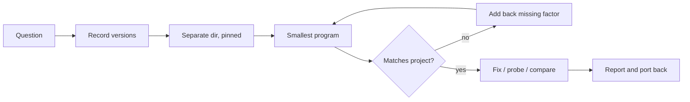

# Minimal Repro

Reading code and docs gives a belief. Running a small program gives a fact. This skill builds the smallest separate program that answers one question, with the same versions as the project, so that the answer also holds in the project.

## When to use

- A bug is hard to see inside the full app: too much setup, slow builds, or too much noise.
- You want to test a fix without touching the project until it works.
- You need the real behavior of a package or API: what it returns, what it throws, what it does with edge input, or what changed between two versions.
- Someone (a person, a doc, or you) states how a dependency behaves, and the work depends on that statement being true.

## Method

1. **Write the question.** One sentence with an observable answer, for example: "Does `parse()` in lib 4.2.1 throw or return `null` on an empty string?" One repro answers one question.
2. **Record the environment of the project.** Find the runtime version and the resolved version of each package involved. Use the lockfile, not the manifest range. See `references/ecosystems.md`. Note relevant config: flags, locale, time zone, build mode.
3. **Make the repro directory outside the project.** Use a scratch or temporary directory. Never install into the environment, `node_modules`, venv, or lockfile of the project. If the user wants to keep the repro, put it in a directory they choose.
4. **Pin the same versions.** Pin the runtime and each involved package exactly to the recorded versions. Add only the packages that the question needs. Copy the lockfile only when the dependency tree itself can matter, for example a transitive version or a peer dependency.
5. **Write the smallest program that shows the behavior.** Start from the code path in the project, copied or rewritten, and remove parts until the behavior goes away. Then keep the last version that still shows it. Print the resolved versions at run time, and print the inputs and the observed result.
6. **Run it and read the output.** Check that the behavior matches what the project shows. If it does not, the repro has lost a factor. Compare versions, config, input data, and call order, and add back what is different.
7. **Use the repro.**
   - For a bug: apply the fix in the repro, show that the output changes, then port the fix to the project and verify it there.
   - For an API question: vary the inputs that matter (empty, null, large, unicode, concurrent, error from the server) and record each result.
   - For a version question: run the same program against both versions.
8. **Report** in the format below. Offer to turn the repro into a regression test in the project.

## Rules

- **Same versions or say so.** If you cannot match a version (not available, wrong platform), write the difference in the report. A result from a different version is a hint, not an answer.
- **Print, do not assume.** The program prints the resolved versions and the actual results. Do not report a result that you did not see in the output.
- **The project stays clean.** No installs, no edits, no new files in the project until a fix is proven in the repro and the user wants it ported.
- **Real services need permission.** Before a repro calls a real API, ask the user. Use a sandbox or a test account if one exists, prefer read-only calls, and keep secrets out of the repro files and the output.
- **Small means small.** If the repro is larger than about 50 lines, or needs most of the app, keep removing parts. If you cannot remove them, say that the behavior depends on the larger system. That is also a finding.
- **A repro that does not reproduce is a result.** Report it and say which factors you matched. Do not change the repro until it gives the expected answer.

## Output format

1. **Question.** The sentence from step 1.
2. **Environment.** Runtime and package versions, with their source (lockfile path), and any difference from the project.
3. **Repro.** The path of the directory, the program (or its key part), and the command to run it.
4. **Observed.** The actual output, trimmed to what matters.
5. **Answer.** The answer to the question, and how sure it is (for example, matched all versions, or different OS).
6. **Next step.** The fix to port, the regression test to add, or the follow-up question.

Pairs with `double-check`: use a repro to confirm a suspected bug in its verification pass.
